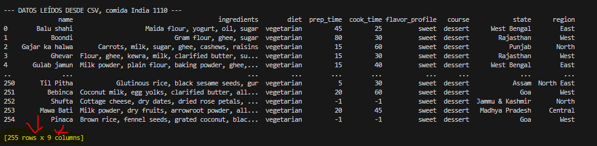
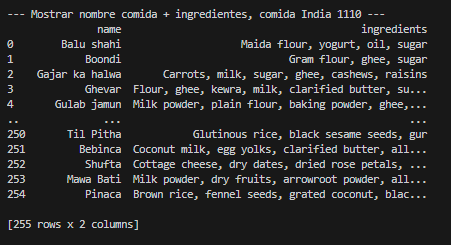
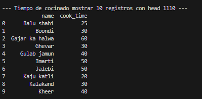
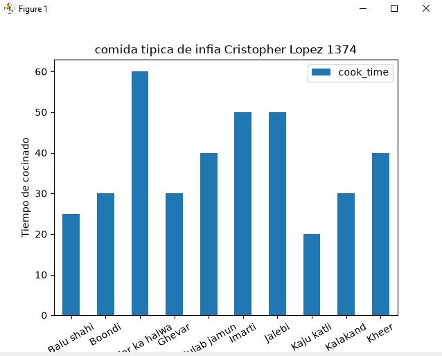
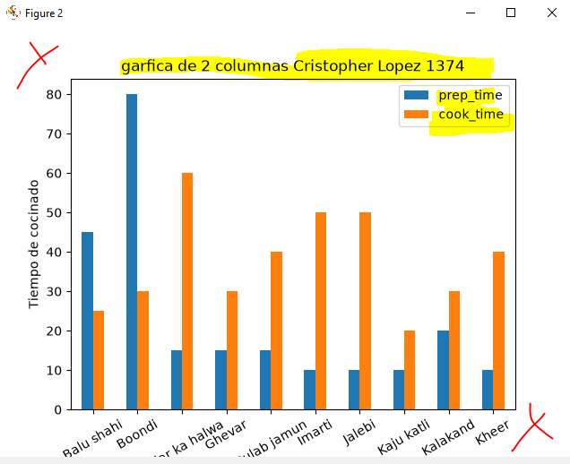
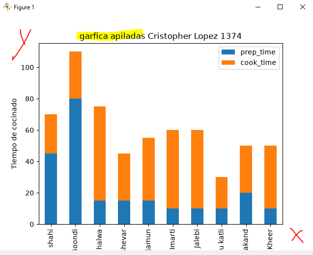

## Analisis exploratorio de datos 
## comida del pais de india 
## cristopher lopez NC 1374
### +-+-+- importando datos del archivo csv comida de india 1374

### mostrar nombre de comda + ingredientes 

### --- Tiempo de cocinado mostrar 10 registros con head 1374 ---

## creacion de graficas de barras 1374

## creacion de graficas de varias columnas 

## grafica apilada
